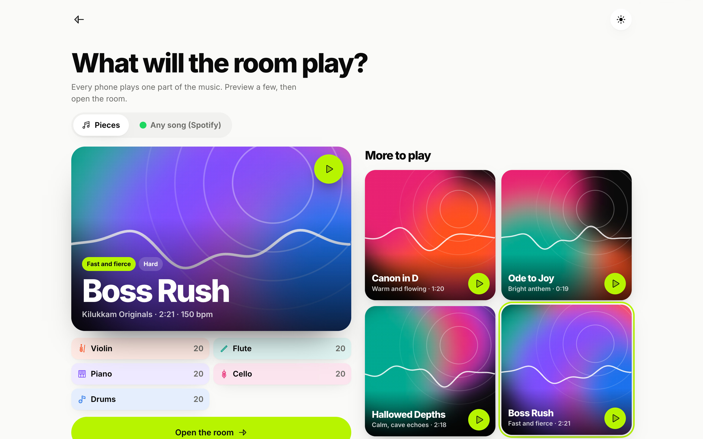
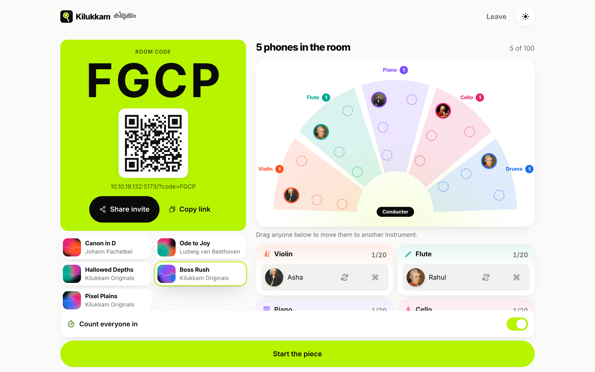
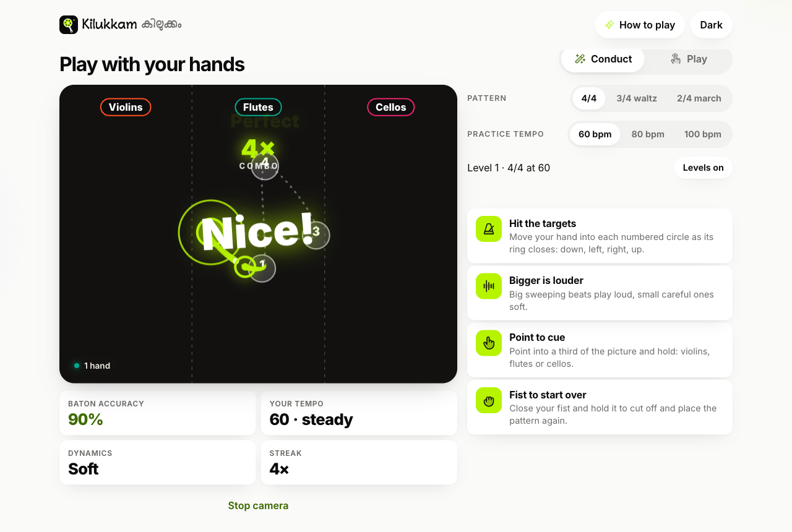
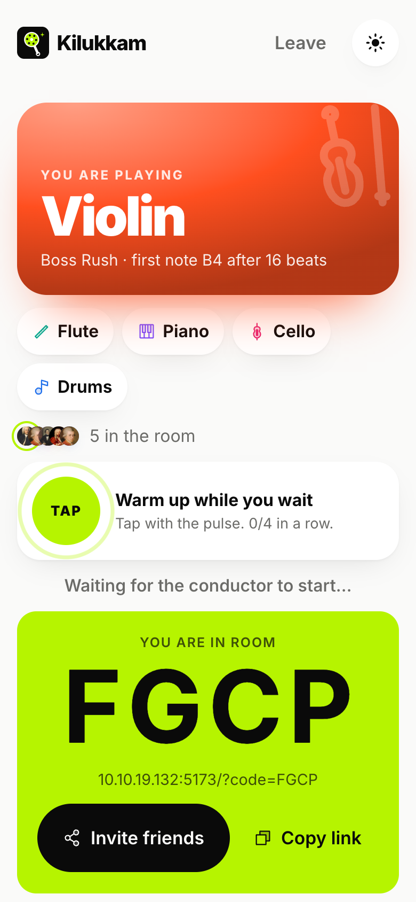
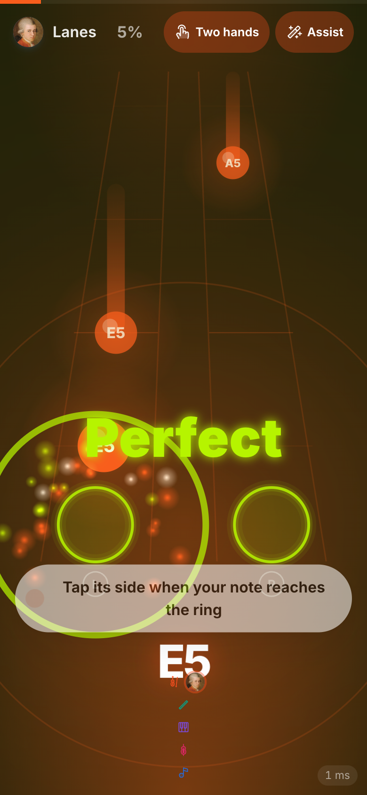

<div align="center">


# Kilukkam · കിലുക്കം

**Kilukkam (കിലുക്കം) turns a room full of phones into an orchestra:
one conductor, one entry code, and every tap plays the next note of
any song, together.**

[](web/package.json)
[](tsconfig.base.json)
[](web/package.json)
[](#testing)
<br>
[](web/src/lib/audio.ts)
[](web/src/lib/camera)
[](web/src/lib/spotify)
[](#license)

**[How it plays](#how-it-plays) · [Features](#feature-tour) · [Screenshots](#screenshots) · [Quick start](#quick-start) · [Architecture](#architecture) · [Credits](#credits)**

Built for **DevDay Exchange Kochi**, track 4: *Make room for play*.

</div>

---

## How it plays

```
Conductor (laptop)                       Players (phones)
──────────────────                       ────────────────
1. Pick the music: a piece, an     ─┐
   original, or any Spotify song    │
2. Open the room: a 4-letter code  ─┼──▶ 3. Type or scan the code, pick a
   and a QR on a lime card          │       composer avatar
                                    │    4. Get an instrument straight away
5. Watch the seats fill, then start ─┘       (swap if you like), warm up
6. Conduct: by hand on the camera,       7. Play: notes fall in two lanes,
   or with the live controls                tap the left or right side on
                                            the beat, chase the combo
8. The piece ends itself: Well played    9. Your grade, timing breakdown
   and an encore button                     and a result card to share
```

Every phone plays its own part out loud, so the music comes from where
people sit. Timing is judged against one shared beat (Perfect within
50 ms), and the conductor can lead the room by hand in front of the
laptop camera.

## Feature tour

| | Feature | What it does |
|---|---|---|
| 🎻 | **Real instruments** | Violin, cello, flute and piano are real recordings (VSCO 2 CE, CC0), with articulations; drums are a synthesised kit and the guitar a modelled plucked string for fingerstyle. Each phone plays its own part. |
| 🙌 | **Two hands** | Notes come down a left or right lane: thumbs on a phone, F and J on a laptop. Wrong side breaks the combo. Grades spring up with particles; streaks cheer. |
| 🪄 | **Camera conductor** | MediaPipe hand tracking, on the device. Hit the numbered targets of a 2/4, 3/4 or 4/4 pattern as their rings close, with levels; point into a labelled third to cue Violins, Flutes or Cellos; the left hand shapes dynamics; a fist cuts off. |
| 🎧 | **Any song (Spotify)** | Search a song or open a playlist, tap along to find its beat, and the room plays drums, claps, bass, a pad and fingerstyle guitar in time with the real recording on the conductor laptop, with a now-playing card that shows it is on the beat. |
| 💿 | **Music shelf** | Animated covers drawn from each piece's instruments, with 12 second previews. Classics and game-style originals (Boss Rush, Pixel Plains, Hallowed Depths). |
| 🪑 | **Seating chart** | The conductor watches avatars take their seats section by section, drags anyone to another instrument, shares the invite link or QR. |
| 🏆 | **Results** | A grade, accuracy, best combo and a timing breakdown per player, the room's total notes, and a result card to share. |
| 📡 | **Built for a full room** | Up to 100 phones, NTP-style clock sync, aggregated `ensemble_pulse` broadcasts, rate limiting and validated messages. |
| 🌓 | **Light and dark** | Light by default, dark on a switch; keyboard play, reduced motion and phone-first layouts throughout. |

### Pieces

| Piece | Instruments | Feel |
|---|---|---|
| Canon in D, Pachelbel | Violin I, II, III (true canon stagger) + Cello | Warm and flowing, the classic |
| Ode to Joy, Beethoven | Flute, Violin, Piano, Cello, Guitar | A first run, all quarter notes |
| Romance (Spanish Romance), Anonymous | Guitar (the melody), Violin, Cello | Tender fingerstyle, 3/4 |
| Greensleeves, Traditional | Flute, Guitar, Cello, Piano | Old English folk, 3/4 |
| In the Hall of the Mountain King, Grieg | Violin, Cello, Guitar, Piano, Drums | Sneaky, then wild |
| Für Elise, Beethoven | Piano, Guitar, Cello, Flute | Delicate classic |
| Hallowed Depths, Kilukkam Originals | Flute, Violin, Piano, Cello | Calm, cave echoes |
| Boss Rush, Kilukkam Originals | Violin, Flute, Piano, Cello, Drums | Fast and fierce, 150 bpm |
| Pixel Plains, Kilukkam Originals | Flute, Violin, Piano, Cello, Drums | Bouncy 8-bit overworld |
| Any song on Spotify | Drums, Claps, Bass, Pad, Guitar | Plays along with the real recording |

## Screenshots

| Home | Pick the music | The room |
|---|---|---|
|  |  |  |

| Conducting the room | Camera conductor | Your instrument | Two hands |
|---|---|---|---|
|  |  |  |  |

## Quick start

Requires Node 20+.

```sh
npm install
npm run dev --workspace server   # ws server on :8787
npm run dev --workspace web      # vite on :5173, proxies /ws to :8787
```

Then on any phone on the same Wi-Fi, open `http://<your-lan-ip>:5173`.
The conductor opens the same URL on the big screen or a laptop and
taps **Create a room**.

> Tip: on macOS, `ipconfig getifaddr en0` prints your LAN IP.

## Testing

```sh
npm test          # 141 vitest tests across all workspaces
npm run typecheck # strict tsc across all workspaces
```

`scripts/room-sim.ts` simulates a full room for load and protocol
checks.

## Architecture

```
  ┌──────────┐  ┌──────────┐        ┌──────────┐
  │ Phone 1  │  │ Phone 2  │  ...   │Conductor │   WebAudio synth on
  │ (player) │  │ (player) │        │ (screen) │   every device
  └────┬─────┘  └────┬─────┘        └────┬─────┘
       │  note_played │   ensemble_pulse  │ note_echo
       └──────────────┼───────────────────┘
                      │  WebSocket  /ws
               ┌──────┴───────┐
               │  ws adapter  │  server/  :8787
               ├──────────────┤
               │  RoomEngine  │  pure, socket-free
               └──────────────┘

  web/  Vite static bundle (:5173 in dev), served to every device
  shared/  protocol validators + score format + pieces, used by both
```

- `shared/`: protocol validators, score format, piece library (pure TS,
  zero runtime deps)
- `server/`: socket-free `RoomEngine` + thin `ws` adapter (`:8787`)
- `web/`: Vite + vanilla TS client, WebAudio instruments (`:5173`)

The game logic never touches sockets and the audio never touches the
network: the engine is designed to lift into a Cloudflare Durable
Object later, and the client to a static Pages deploy.

Deeper reading: [docs/ARCHITECTURE.md](docs/ARCHITECTURE.md),
[docs/PROTOCOL.md](docs/PROTOCOL.md), [docs/DECISIONS.md](docs/DECISIONS.md).

## Contributing

PRs are welcome, from first-time contributors too.

1. Fork, branch, and run the quick start above.
2. Keep each PR to one concern and a small diff.
3. Run `npm test` and `npm run typecheck` before opening the PR.
4. Fill in the [pull request template](.github/pull_request_template.md),
   including screenshots for anything visual.

House rules worth knowing up front (see [AGENTS.md](AGENTS.md)):

- Strict TypeScript; user strings reach the DOM via `textContent` only.
- Every WebSocket payload goes through the `@kilukkam/shared` validators.
- No em dashes or en dashes in copy, docs or comments.
- Player-facing copy says "instrument", never "track".
- Update [CHANGELOG.md](CHANGELOG.md) in the same commit as the change.

## Credits

- **Icons:** most icons are [Phosphor Icons](https://phosphoricons.com)
  (MIT, Copyright (c) 2023 Phosphor Icons), vendored as path data. The
  violin, cello and flute are drawn in the same duotone style.
- **Composer portraits:** sourced from Wikimedia Commons, cropped and
  resized to 256x256. Full per-file attribution lives in
  [web/public/composers/CREDITS.md](web/public/composers/CREDITS.md).
  All portraits are public domain except A.R. Rahman:
  *"AR Rahman at Premier Futsal Press Meet (cropped)"* by Sriram
  Narasimhan, via [Wikimedia Commons](https://commons.wikimedia.org/wiki/File:AR_Rahman_at_Premier_Futsal_Press_Meet_(cropped).jpg),
  licensed [CC BY-SA 4.0](https://creativecommons.org/licenses/by-sa/4.0/),
  cropped and resized.
- **Instrument samples:** VSCO 2 Community Edition (CC0); see
  [web/public/samples/CREDITS.md](web/public/samples/CREDITS.md).
- **Hand tracking:** MediaPipe Tasks Vision (Apache 2.0), self-hosted.
  Video never leaves the device, and the library's usage metrics are
  blocked by the page's Content Security Policy.
- **Fonts:** Inter via Fontsource; RIT Ala (Rachana Institute of
  Typography) for the Malayalam name; Anek Malayalam (EK Type) for other
  Malayalam text. All under the SIL Open Font License; licence texts
  are in [web/public/fonts](web/public/fonts).
- **Music:** Canon in D (Pachelbel), Ode to Joy and Für Elise
  (Beethoven), In the Hall of the Mountain King (Grieg), Romance
  (anonymous) and Greensleeves (traditional) are in the public domain; arrangements are original to this repo, as are the
  Kilukkam Originals. Spotify play-along streams the user's own Spotify
  account; no recordings are bundled.
- **AI assistance:** see [AI_USAGE.md](AI_USAGE.md).

## License

Released under the MIT License. Copyright (c) 2026 Alwin John.
