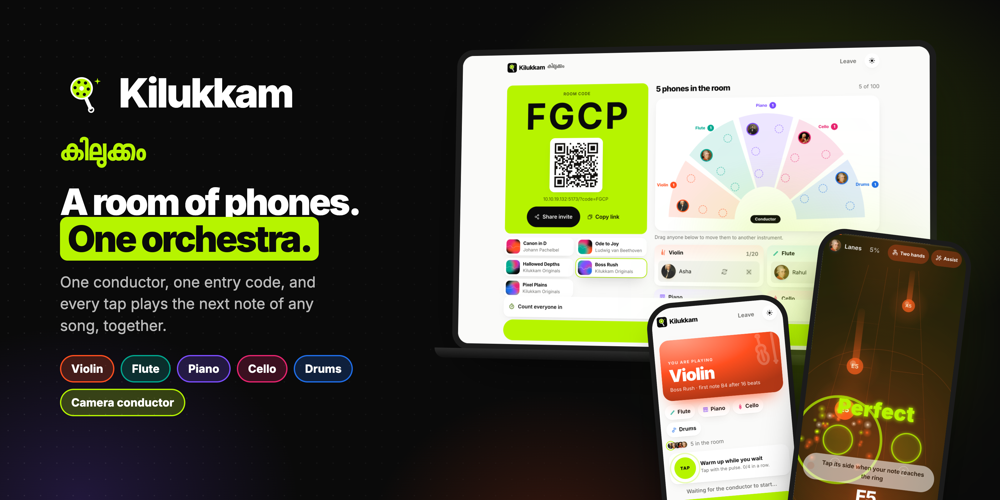
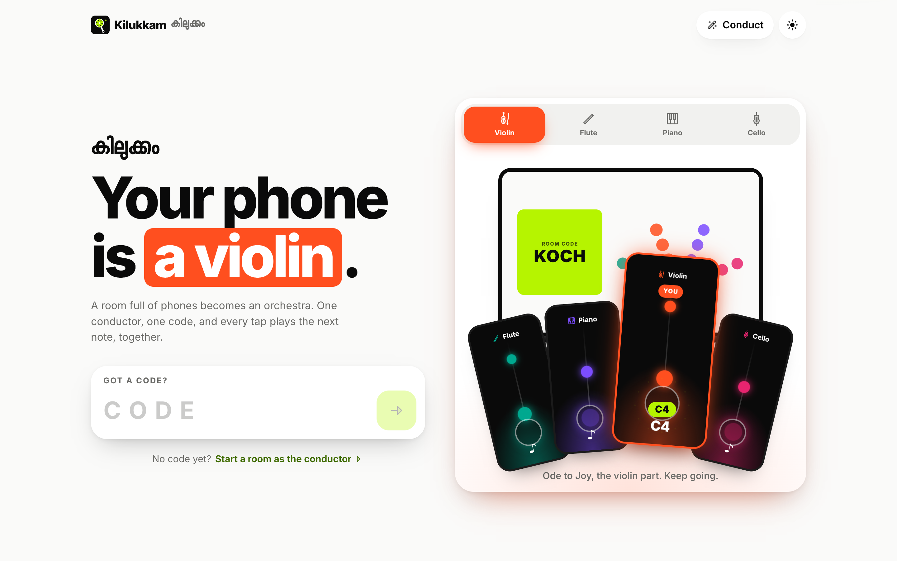
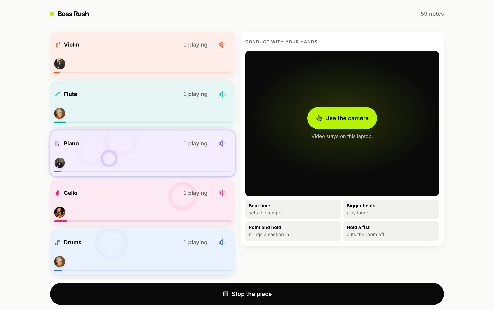

<div align="center">

<!-- HERO BANNER: drop the final banner at docs/screenshots/hero.png and uncomment:

-->

# Kilukkam · കിലുക്കം

**Kilukkam (കിലുക്കം) turns a room full of phones into an orchestra:
one conductor, one entry code, and every tap plays the next note of
any song, together.**

One person conducts. Everyone else joins with a 4-letter code and gets
an instrument. Every tap plays the next note of your part: a
hundred-device handbell choir playing Pachelbel in your living room.

[](tsconfig.base.json)
[](web/package.json)
[](#testing)
[](#license)
[](#contributing)

[Features](#feature-tour) · [Quick start](#quick-start) · [Architecture](#architecture) · [Contributing](#contributing) · [Credits](#credits)

</div>

---

## How it works

```
Conductor                          Players
─────────                          ───────
1. Pick a piece        ──code──▶   2. Type code, name, avatar
3. Watch the lobby fill            4. Claim an instrument (or "Surprise me")
5. Tap "Start the piece"           6. One giant button: tap = next note
                                   7. Your phone *is* your instrument
```

There are no skill checks and no timing lanes. The room's humans are
the timing. When the ensemble taps in roughly the same place, it
sounds like music. When it doesn't, it sounds like a party. Both are
correct.

## Feature tour

| | Feature | What it does |
|---|---|---|
| 🔔 | **Tap-to-play handbell model** | Each phone holds one part of the score. A tap advances that player's cursor by one note, so timing is entirely human and network latency barely matters. |
| 📡 | **Live sync via `ensemble_pulse`** | The server aggregates taps into a ~4 Hz per-instrument pulse broadcast to everyone, so 100 phones see the room breathe without a 100x fan-out per tap. Raw `note_echo` goes to the conductor only. |
| 🎛️ | **Conductor console** | Pick the piece, watch the lobby fill, start, stop and encore. Shape the performance live with dynamics (pp to ff) and mute or unmute whole sections. Late joiners receive the current dynamics and mutes in their snapshot. |
| 📷 | **QR join** | The lobby shows the 4-letter code plus a QR code of the LAN join link (a dependency-free encoder in `web/src/qr.ts`). Point a camera, tap, play. |
| 🎙️ | **Recording and share** | The conductor's device keeps a take of the room's real performance from every note echo, renders it to audio and hands it off through the share sheet. |
| 🎼 | **Custom-piece import (MIDI)** | Bring your own score: the conductor uploads a piece, the server validates it (up to 8 instruments, 2000 notes each) and broadcasts `piece_changed` to the room. |
| 🎩 | **Composer avatars** | Players pick Bach, Vivaldi, Mozart, Beethoven, Clara Schumann, A.R. Rahman and friends, rendered as portrait discs. |
| 📱 | **Phones first** | 64px+ tap targets, safe areas, haptics, GSAP motion that honours `prefers-reduced-motion`, zero install. |

### Pieces

| Piece | Instruments | Feel |
|---|---|---|
| Canon in D, Pachelbel | Violin I, II, III (true canon stagger) + Cello | The demo piece. 24 bars, about 80s |
| Ode to Joy, Beethoven | Flute + Violin + Piano + Cello | Beginner friendly, all quarter notes |

## Screenshots

> **Pending:** real captures land in `docs/screenshots/`. The paths below
> are placeholders and will render once the images are committed.

<!--
| Home | Lobby with QR | Play | Conductor stage |
|---|---|---|---|
|  |  |  |  |
-->

## Quick start

Requires Node 20+.

```sh
npm install
npm run dev --workspace server   # ws server on :8787
npm run dev --workspace web      # vite on :5173, proxies /ws to :8787
```

Then on any phone on the same Wi-Fi, open `http://<your-lan-ip>:5173`.
The conductor opens the same URL on the big screen or a laptop and
taps **Create a room**.

> Tip: on macOS, `ipconfig getifaddr en0` prints your LAN IP.

## Testing

```sh
npm test          # 141 vitest tests across all workspaces
npm run typecheck # strict tsc across all workspaces
```

`scripts/room-sim.ts` simulates a full room for load and protocol
checks.

## Architecture

```
  ┌──────────┐  ┌──────────┐        ┌──────────┐
  │ Phone 1  │  │ Phone 2  │  ...   │Conductor │   WebAudio synth on
  │ (player) │  │ (player) │        │ (screen) │   every device
  └────┬─────┘  └────┬─────┘        └────┬─────┘
       │  note_played │   ensemble_pulse  │ note_echo
       └──────────────┼───────────────────┘
                      │  WebSocket  /ws
               ┌──────┴───────┐
               │  ws adapter  │  server/  :8787
               ├──────────────┤
               │  RoomEngine  │  pure, socket-free
               └──────────────┘

  web/  Vite static bundle (:5173 in dev), served to every device
  shared/  protocol validators + score format + pieces, used by both
```

- `shared/`: protocol validators, score format, piece library (pure TS,
  zero runtime deps)
- `server/`: socket-free `RoomEngine` + thin `ws` adapter (`:8787`)
- `web/`: Vite + vanilla TS client, WebAudio instruments (`:5173`)

The game logic never touches sockets and the audio never touches the
network: the engine is designed to lift into a Cloudflare Durable
Object later, and the client to a static Pages deploy.

Deeper reading: [docs/ARCHITECTURE.md](docs/ARCHITECTURE.md),
[docs/PROTOCOL.md](docs/PROTOCOL.md), [docs/DECISIONS.md](docs/DECISIONS.md).

## Contributing

PRs are welcome, from first-time contributors too.

1. Fork, branch, and run the quick start above.
2. Keep each PR to one concern and a small diff.
3. Run `npm test` and `npm run typecheck` before opening the PR.
4. Fill in the [pull request template](.github/pull_request_template.md),
   including screenshots for anything visual.

House rules worth knowing up front (see [AGENTS.md](AGENTS.md)):

- Strict TypeScript; user strings reach the DOM via `textContent` only.
- Every WebSocket payload goes through the `@kilukkam/shared` validators.
- No em dashes or en dashes in copy, docs or comments.
- Player-facing copy says "instrument", never "track".
- Update [CHANGELOG.md](CHANGELOG.md) in the same commit as the change.

## Credits

- **Icons:** most icons are [Phosphor Icons](https://phosphoricons.com)
  (MIT, Copyright (c) 2023 Phosphor Icons), vendored as path data. The
  violin, cello and flute are drawn in the same duotone style.
- **Composer portraits:** sourced from Wikimedia Commons, cropped and
  resized to 256x256. Full per-file attribution lives in
  [web/public/composers/CREDITS.md](web/public/composers/CREDITS.md).
  All portraits are public domain except A.R. Rahman:
  *"AR Rahman at Premier Futsal Press Meet (cropped)"* by Sriram
  Narasimhan, via [Wikimedia Commons](https://commons.wikimedia.org/wiki/File:AR_Rahman_at_Premier_Futsal_Press_Meet_(cropped).jpg),
  licensed [CC BY-SA 4.0](https://creativecommons.org/licenses/by-sa/4.0/),
  cropped and resized.
- **Fonts:** Space Grotesk and Inter via Fontsource (SIL Open Font
  License).
- **Music:** Canon in D (Pachelbel) and Ode to Joy (Beethoven) are in
  the public domain; arrangements are original to this repo.
- **AI assistance:** see [AI_USAGE.md](AI_USAGE.md).

## License

Released under the MIT License. Copyright (c) 2026 Alwin John.
